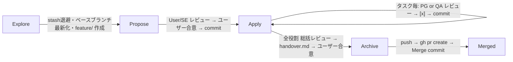

# openspec-kit

[OpenSpec](https://github.com/Fission-AI/OpenSpec) の標準ワークフロー（`spec-driven`）に、**役割別サブエージェントレビュー・TDD・Git/PR 運用**を上乗せするための汎用キット。
実プロジェクト（ChCalendarFromFess）での運用から、アプリ固有でない部分を抽出・汎用化したもの。

## 構成

| ファイル                            | 役割                                                                                                         |
| ----------------------------------- | ------------------------------------------------------------------------------------------------------------ |
| `config.yaml`                       | `openspec/config.yaml` の雛形。`context` / `rules` / `operations` で CLI からエージェントへルールを注入      |
| `AGENTS.openspec.md`                | `AGENTS.md` のマーカー区間に挿入する運用ルール（レビュー手順・テスト・UI モック・Git/PR・CLI リファレンス）  |
| `AGENTS.project.md`                 | `AGENTS.md` 新規作成時に区間外へ出力するプロジェクト固有ルールの雛形（概要・フォーマットコマンド・実装規約） |
| `templates/review_record.md`        | レビュー記録（`reviews.md` に追記する単位）                                                                  |
| `templates/checklist_propose.md`    | Propose レビュー（User / SE Agent）                                                                          |
| `templates/checklist_apply_impl.md` | Apply 実装タスクレビュー（PG Agent）                                                                         |
| `templates/checklist_apply_test.md` | Apply テストタスクレビュー（QA Agent）                                                                       |
| `templates/checklist_archive.md`    | Archive 総括レビュー（全役割）＋ユーザー最終合意                                                             |
| `templates/handover.md`             | Archive 時の申し送り（変更サマリ・テスト結果・保留指摘・改善候補）                                           |
| `templates/pr_body.md`              | Spec 駆動の PR 本文テンプレート                                                                              |
| `install.ps1`                       | 対象プロジェクトへの導入・再同期スクリプト                                                                   |

## ワークフロー概要



## 導入手順

1. 対象プロジェクトで `openspec init` を実行する（スキル・コマンドが生成される）。
2. キットを導入する（まず `-WhatIf` で確認推奨）:
   ```powershell
   pwsh ./openspec-kit/install.ps1 -TargetPath <project-root> -BaseBranch develop -EvidenceDir test/TestResults/ -WhatIf
   pwsh ./openspec-kit/install.ps1 -TargetPath <project-root> -BaseBranch develop -EvidenceDir test/TestResults/
   ```
3. プロジェクト固有の TODO を記入する:
   - `openspec/config.yaml` の `context` → 技術スタック、テストフレームワーク等
   - `AGENTS.md` の管理区間外 → プロジェクト概要、「自動フォーマット」表、実装ガイドライン（既存 AGENTS.md に追記した場合は `AGENTS.project.md` を参考に追加）
   - 必要に応じて `checklist_*.md` にプロジェクト固有観点（例: エラーハンドリング方式）を追加
4. 反映確認:
   ```powershell
   openspec new change probe
   openspec instructions proposal --change probe --json   # context / rules が出力されること
   ```
   確認後 `openspec/changes/probe` を削除する。

| 既存ファイル              | 挙動                                                                                                                    |
| ------------------------- | ----------------------------------------------------------------------------------------------------------------------- |
| `openspec/templates/*`    | スキップ（`-Force` で上書き）                                                                                           |
| `openspec/config.yaml`    | `config.kit.yaml` を横に出力して手動マージ（`-OverwriteConfig` でバックアップ後に上書き）                               |
| `AGENTS.md`               | マーカー区間（`openspec-kit:begin/end`）を置換。区間がなければ末尾に追記。新規作成時は `AGENTS.project.md` の雛形＋区間 |
| `.gitignore`              | `EvidenceDir` が未登録なら追記                                                                                          |
| `CLAUDE.md` / `GEMINI.md` | 未作成なら `@AGENTS.md` のみのファイルを作成（AGENTS.md を唯一の正本にする）。既存なら参照有無を警告のみ                |

キット更新後は `-Force` 付きで再実行すれば、テンプレートと AGENTS.md のマーカー区間が再同期される（`config.yaml` は上書きされない。導入済みで `config.kit.yaml` が不要なら `-SkipConfig` を併用）。

## 設計上のポイント

- **ルールは CLI 経由で注入する**: OpenSpec CLI は `config.yaml` の `context`（全成果物）、`rules.<artifact>`（成果物別）、`operations.apply/archive.guidance`（実装・アーカイブ時）を `openspec instructions` の出力に含める。スキル本体（`openspec init` が生成・更新するファイル）を改変せずにワークフローを拡張できるため、`openspec update` で上書きされない。
- **`reviews:` キーは CLI に解釈されない**: レビュー役割・テンプレートの定義（機械可読なメタデータ）として置いているだけで、エージェントへの指示は `context` / `rules` / `operations` / `AGENTS.md` 側に必ず書く。
- **スキル生成ファイルは編集しない**: `.agents/` `.claude/` `.gemini/` 等の `openspec-*` スキルは `openspec update` で再生成される。カスタマイズはこのキットの範囲（config・AGENTS.md・templates）に閉じる。

## 抽出元からの主な変更点

- 技術スタック固有の記述（F#/.NET、xUnit、Giraffe、`dotnet format`、WPF の `RenderTargetBitmap` 等）を汎用表現・TODO に置換
- `checklist_apply_test.md` の項目番号重複（17〜20）を解消し、TDD Red 確認・名ばかり E2E 検出の観点を追加
- `checklist_apply_impl.md` に「仕様の黙った縮小・先送り」「秘密情報」「依存関係のツール経由更新」の観点を追加
- PG Agent の担当フェーズに Archive を追加（「Archive は全役割」との不整合を解消）
- `handover.md` / `pr_body.md` をテンプレートとして新設（抽出元では AGENTS.md 内の記述・実例のみだった）
- OpenSpec CLI リファレンスを 1.15 系の実コマンドに修正（`openspec validate <name>`、`openspec archive <name>` 等）、`skip_specs` を追記
- サブエージェントレビューの実施方法（独立コンテキスト・批判的レビュー・全項目判定）を明文化
