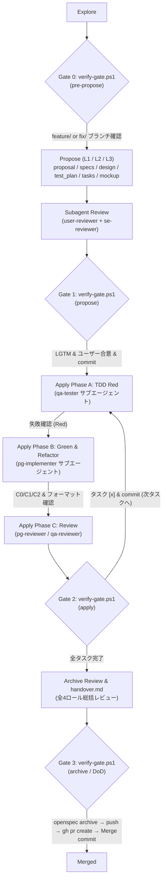

# openspec-kit

[OpenSpec](https://github.com/Fission-AI/OpenSpec) の標準ワークフロー（`spec-driven`）に、**6ロールのサブエージェント分業（TDD 3権分立）・テスト網羅性基準（C0/C1/C2＋境界値＋結合/E2E）・適用規模レベル（L1/L2/L3）・機械的フェーズゲート（Gate 0〜3 / DoD）** を上乗せするための汎用キット。

## 構成

| ファイル / パス                     | 役割                                                                                                                        |
| ----------------------------------- | --------------------------------------------------------------------------------------------------------------------------- |
| `config.yaml`                       | `openspec/config.yaml` の雛形。`context` / `rules` / `operations` で CLI からエージェントへルールを注入                     |
| `AGENTS.openspec.md`                | `AGENTS.md` のマーカー区間に挿入する運用ルール（6ロール分業・C0/C1/C2基準・ゲート・Git/PR）                                 |
| `AGENTS.project.md`                 | `AGENTS.md` 新規作成時に区間外へ出力するプロジェクト固有ルールの雛形                                                        |
| `agents/qa-tester.md`               | **Tester Agent**: `specs/` と `test_plan.md` から先行 Red テスト・結合/E2Eテストを実装（本実装編集禁止）                    |
| `agents/pg-implementer.md`          | **PG Implementer Agent**: Red テストを改ざんせずにプロダクションコード実装（Green）と Refactor を実施                       |
| `agents/user-reviewer.md`           | **User Reviewer Agent**: 要件・UX導線・ゼロ状態/異常時体験・`mockup.html` 忠実性の批判的レビュー                            |
| `agents/se-reviewer.md`             | **SE Reviewer Agent**: アーキテクチャ・責務分離・データ整合・非機能・タスク分解の批判的レビュー                             |
| `agents/pg-reviewer.md`             | **PG Reviewer Agent**: コード品質・境界値・エラー処理・テスト無断改ざん/ハリボテ実装の摘出                                  |
| `agents/qa-reviewer.md`             | **QA Reviewer Agent**: C0/C1/C2・境界値・結合/E2E網羅・モック規律・実画面エビデンスの批判的レビュー                         |
| `templates/test_plan.md`            | テスト計画・テストケース定義書（C0/C1/C2目標、トレーサビリティ、同値分割/境界値、C2表、結合/E2E）                           |
| `templates/review_record.md`        | レビュー記録（`reviews.md` に追記する単位）                                                                                 |
| `templates/checklist_propose.md`    | Propose レビューチェックリスト（Gate 1）                                                                                    |
| `templates/checklist_apply_impl.md` | Apply 実装レビューチェックリスト（AIガードレール・コード品質・エラー処理）                                                  |
| `templates/checklist_apply_test.md` | Apply テストレビューチェックリスト（C0/C1/C2・境界値・結合/E2E・モック規律）                                                |
| `templates/checklist_archive.md`    | Archive 総括レビューチェックリスト（Gate 3 / Definition of Done）                                                           |
| `templates/handover.md`             | Archive 時の申し送り事項テンプレート                                                                                        |
| `templates/pr_body.md`              | Spec 駆動の PR 本文テンプレート                                                                                             |
| `skills/sdd-propose/`               | Gate 0 → 規模レベル判定 → `test_plan.md` → User/SEレビュー → Gate 1 検証スキル（`SKILL.md`・`references/`・`scripts/`）     |
| `skills/sdd-apply/`                 | `qa-tester`(Red) → `pg-implementer`(Green/Refactor) → `pg/qa-reviewer` → Gate 2 検証スキル（`SKILL.md`・`references/`）     |
| `skills/sdd-archive/`               | DoD確認 → `handover.md` → 全ロール総括レビュー → Gate 3 検証 → Archive & PR スキル（`SKILL.md`・`references/`・`scripts/`） |
| `scripts/verify-gate.ps1` / `.sh`    | フェーズゲート（`pre-propose` / `propose` / `apply` / `archive`）を機械的に検査するスクリプト（PowerShell / Bash）        |
| `install.ps1` / `install.sh`        | 対象プロジェクトへの導入・5エージェントスキル多面展開・旧 `workflows/sdd-*.md` 退避（`.bak`）スクリプト                  |

## 設計背景（Why / トレードオフ）

1. **5 エージェント横断配布と Agent Skills (`SKILL.md`) への統一**:
   - **対象エージェント（5種）**: **Antigravity CLI**（`.agents/skills/`）、**Claude Code**（`.claude/skills/`＋`.claude/agents/`）、**GitHub Copilot CLI**（`.github/skills/`）、**OpenCode CLI**（`.opencode/skills/`）、**Hermes Agent**（`.hermes/skills/`）。
   - **ボツ案と選定理由**: 旧 `.agents/workflows/sdd-*.md` は Antigravity 2.0 以降非推奨となり他エージェント非互換であるため廃止した。また Plugin 形式は `.claude-plugin` / `.opencode/plugins` / Hermes `plugin.yaml` で仕様が 3 分裂しているため不採用とし、5 エージェント共通で動作する **Agent Skills（`SKILL.md`＋`references/`・`scripts/` の Progressive Disclosure 構成）** に統一した。
2. **`AGENTS.openspec.md` のスリム化（24,000 バイト上限対策）**:
   - Antigravity CLI にはルールファイル 1 件あたり **24,000 バイト上限（超過時は末尾が切り捨てられる）** がある。詳細な C0/C1/C2 基準表や CLI リファレンスを各スキルの `references/sdd-reference.md` へ退避し、生成直後の `AGENTS.md` を約 15〜16 KB 以下へ圧縮した。
3. **Antigravity CLI 向け Gemini 4 モデル役割分担とメタデータ契約**:
   - **コスト・速度と推論品質の両立**: 計画検証・設計・批判的レビューの 4 ロール（`user-reviewer` / `se-reviewer` / `pg-reviewer` / `qa-reviewer`）には推論重視の **`pro`（Gemini 4 Neon 級）** を、テスト先行生成（`qa-tester`：`thinking: high` で境界値網羅を担保）と実装（`pg-implementer`：`thinking: medium` で高速反復）には高速な **`flash`（Gemini 4 Hydrogen 級）** を割り当てる。非推奨の **Gemini 3.8 Flash** は使用しない。
   - **書き込み分離（物理分離＋単一ライター）**: 批判的レビュアーのうち `user/se/pg-reviewer` は `write_tools: false`（`EnableWriteTools=false`）で編集不可とし、`qa-reviewer` のみ Adversarial QA の破壊テスト実行のため `write_tools: true` としたうえで既存コード・`reviews.md` 編集を禁止する（親エージェントのみが書く単一ライター原則）。
   - **YAML frontmatter の解釈仕様**: `agents/*.md` の `model_tier`・`thinking`・`write_tools` は CLI が自動解釈するネイティブ構文ではなく、**親エージェントやオーケストレータが参照して `define_subagent` / `invoke_subagent` 引数・プロンプト指示へ反映する運用規約メタデータ** である（他エージェント環境では汎用参照情報として扱う）。

## レビュープロトコル設計思想（成果物7種 × 4アプローチ選定）

本キットのレビュー機構（チェックリスト・エージェント指示）は、AIによる同語反復（トートロジー）や追認を排除するため、**「7種の主要成果物」**と**「4つの批判的レビューアプローチ案」**のマトリックス検討を経て、成果物ごとに最適なアプローチを選定・採用しています。

- **検討された4つのアプローチ候補**:
  - **A. Adversarial QA（破壊テスト実行型）**: 言葉の追認を排し、実装コードを例外終了・失敗させるテストコードを書いて実行ログで客観判定。
  - **B. 悪魔の代弁者（死角・故障・負債告発型）**: 故障シミュレーション、本番ですり抜ける死角トップ2、隠された技術的負債・時限爆弾を強制自白。
  - **C. ブラインド仕様比較（先出し突合型）**: 仕様書を読む前に上位背景から異常系をゼロベースで先出し推論し、仕様書の考慮漏れをあぶり出す。
  - **D. 特化ペルソナ（視点特化型）**: せっかち初心者（Zero-State/Error-State検証）、コード潔癖症（30%削減リファクタ案）、初見エンジニア（Why欠落告発）。

| 成果物                          | 採用アプローチ                | レビューの狙い                                                  |
| :------------------------------ | :---------------------------- | :-------------------------------------------------------------- |
| **仕様書 (`specs/`)**           | **C. ブラインド比較（＋B）**  | 背景から異常系5点を先出し推論し、仕様書の考慮漏れをあぶり出す   |
| **設計書 (`design.md`)**        | **B. 悪魔の代弁者**           | 外部依存5秒ハング・切断時の故障シミュレーションと連鎖崩壊を追及 |
| **テスト計画 (`test_plan.md`)** | **B. 悪魔の代弁者**           | 全テストPassしても本番ですり抜ける死角トップ2を告発             |
| **UIモック (`mockup.html`)**    | **D. 特化ペルソナ（初心者）** | データ0件の初期状態（Zero-State）とエラー回復導線の不備を追及   |
| **実装コード (プロダクション)** | **A. Adversarial QA ＋ D**    | 例外を起こす破壊テストを実行して客観判定＋30%コード削減案を提示 |
| **テストコード (テスト実装)**   | **B. 悪魔の代弁者**           | 実装式コピペのトートロジーアサーションや甘い検証を告発          |
| **引き継ぎ書 (`handover.md`)**  | **B. 悪魔の代弁者 ＋ D**      | 工数都合で見て見ぬふりをした負債の自白＋初見でのWhy欠落告発     |

## ワークフロー概要（TDD 3権分立 & フェーズゲート）



## 導入手順

1. 対象プロジェクトで `openspec init` を実行する。
2. キットを導入する（まず `-WhatIf` / `--dry-run` で確認推奨。展開先エージェントは `-AgentTargets` / `--agent-targets` で制御し、既定は `auto`）:
   ```powershell
   # PowerShell (Windows / Cross-Platform)
   # 既定 (-AgentTargets auto): .agents/skills は必須配置し、.claude / .github / .opencode / .hermes は既存ディレクトリを自動検出して展開
   pwsh ./openspec-kit/install.ps1 -TargetPath <project-root> -BaseBranch develop -EvidenceDir test/TestResults/ -WhatIf
   pwsh ./openspec-kit/install.ps1 -TargetPath <project-root> -BaseBranch develop -EvidenceDir test/TestResults/

   # 全 5 エージェント向け展開 / 個別指定 / キット変更後の本リポジトリ再同期
   pwsh ./openspec-kit/install.ps1 -TargetPath <project-root> -BaseBranch develop -EvidenceDir test/TestResults/ -AgentTargets all
   pwsh ./openspec-kit/install.ps1 -TargetPath . -BaseBranch main -EvidenceDir test-results/ -AgentTargets all -Force -SkipConfig
   ```
   ```bash
   # Bash (Linux / macOS / Git Bash / WSL)
   ./openspec-kit/install.sh --target-path <project-root> --base-branch develop --evidence-dir test/TestResults/ --agent-targets auto --dry-run
   ./openspec-kit/install.sh --target-path <project-root> --base-branch develop --evidence-dir test/TestResults/ --agent-targets all
   ```
   - **指定可能な `-AgentTargets` / `--agent-targets` 値**: `auto`（既定）、`all`、または `antigravity`, `claude`, `copilot`, `opencode`, `hermes` のカンマ区切り。
   - **再同期時の注意**: `-SkipConfig` を付けて再同期した場合、`openspec/config.yaml` は自動更新されないため `openspec-kit/config.yaml` との差分を手動で反映する。
3. プロジェクト固有の TODO を記入する:
   - `openspec/config.yaml` の `context` → 技術スタック、テストフレームワーク等
   - `AGENTS.md` の管理区間外 → プロジェクト概要、「自動フォーマット」表、実装ガイドライン

| 配置先                                                     | 既存ファイルがある場合の挙動                                                                                                                       |
| ---------------------------------------------------------- | -------------------------------------------------------------------------------------------------------------------------------------------------- |
| `openspec/templates/*`                                     | スキップ（`-Force` で上書き）                                                                                                                      |
| `openspec/agents/*` (`.claude/agents`)                     | スキップ（`-Force` で上書き。`claude` ターゲット指定・検出時、または `.claude/` 既存時は `.claude/agents/*` も展開）                               |
| `openspec/scripts/verify-gate.ps1` / `.sh`                 | スキップ（`-Force` で上書き）                                                                                                                      |
| `.agents/skills/sdd-*`（および `.claude/skills/sdd-*` 等） | スキップ（`-Force` で上書き）※ `openspec update` でも消えない `sdd-*` 名前空間。旧 `.agents/workflows/sdd-*.md` が残存する場合は `.bak` へ自動退避 |
| `openspec/config.yaml`                                     | `config.kit.yaml` を横に出力（`-OverwriteConfig` でバックアップ後に上書き、`-SkipConfig` でスキップ）                                              |
| `AGENTS.md`                                                | マーカー区間（`openspec-kit:begin/end`）を置換。区間がなければ末尾に追記                                                                           |
| `.gitignore`                                               | `EvidenceDir` が未登録なら追記                                                                                                                     |
| `CLAUDE.md` / `GEMINI.md`                                  | 未作成なら `@AGENTS.md` のみのファイルを作成                                                                                                       |

## トラブルシューティング・復旧・ロールバック

- **`run_propose_review.py` / `run_archive_review.py` が終了コード `2` または `ValueError` で停止する**:
  - 両スクリプトは Antigravity CLI の `run_workflow` ツール専用（リポジトリルート基準で `.agents/skills/sdd-{propose,archive}/scripts/run_*_review.py`、`args={"change_name": "<name>"}` で起動）。通常の `python` / `python3` で直接起動した場合は設定どおり終了コード `2` で安全停止するため、各スキルの `SKILL.md` 手順または `references/antigravity-orchestration.md` §3（`invoke_subagent`）に従う。`parallel` が部分失敗した場合は同書 §6 の手順で未完了ロールのみ個別再実行する。
- **`AGENTS.md` が 24,000 バイト以上（`[warn]`）と警告された / マーカー破損エラーが出た**:
  - キット管理区間（`<!-- openspec-kit:begin -->`〜`<!-- openspec-kit:end -->`）の内側を削ると次回再同期時に上書きされるため、**管理区間外**のプロジェクト固有説明を別ドキュメントへ分割すること（また独自本文中にマーカープレフィックス文字列自体を書かないこと）。マーカー破損エラー時は `<!-- openspec-kit:begin ... -->` と `<!-- openspec-kit:end -->` のペアを整えて再実行する。
- **スキル更新スキップ警告や導入途中での失敗（ファイルロック・読み取り専用等）**:
  - 既存スキルのスキップ警告が出た場合や途中失敗を解消した後は、対象ファイルのロックや読み取り専用を解除したうえで `-Force`（Bash: `--force`）を付けて再実行する。
- **旧 `.agents/workflows/sdd-*.md` 退避後の `.bak` 整理・旧構成へのロールバック**:
  - 旧 `.agents/workflows/sdd-*.md` の退避物（`.bak*`、衝突時は連番付き）は内容を確認・移植した後に削除してよいが、同ディレクトリの `opsx-*.md` は `openspec init/update` 生成物のため削除しないこと。
  - **ロールバック手順**: 本リポジトリ側は PR マージコミットの `git revert -m 1` で復帰できる。外部導入先で旧版キットへ巻き戻す場合は、旧版インストーラだけでは今回追加展開された `skills/sdd-*`（最大 5 エージェント配下）を削除できないため、各 `.*/skills/sdd-*` を手動削除し、必要に応じて旧 `.agents/workflows/sdd-*.md` の退避ファイル（`.bak*`）を元のファイル名へリネーム復元する。
- **`.openspec.yaml` で `openspec` CLI が `level:` キー警告を出す場合**:
  - `x-level: L2` を使用し、`proposal.md` 先頭にも規模レベル（`L1` / `L2` / `L3`）を明記すると、`verify-gate` はフォールバックにより規模レベルを正しく判定できる。
