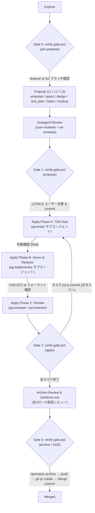

# openspec-kit

[OpenSpec](https://github.com/Fission-AI/OpenSpec) の標準ワークフロー（`spec-driven`）に、**6ロールのサブエージェント分業（TDD 3権分立）・テスト網羅性基準（C0/C1/C2＋境界値＋結合/E2E）・適用規模レベル（L1/L2/L3）・機械的フェーズゲート（Gate 0〜3 / DoD）** を上乗せするための汎用キット。

## 構成

| ファイル / パス                     | 役割                                                                                                     |
| ----------------------------------- | -------------------------------------------------------------------------------------------------------- |
| `config.yaml`                       | `openspec/config.yaml` の雛形。`context` / `rules` / `operations` で CLI からエージェントへルールを注入  |
| `AGENTS.openspec.md`                | `AGENTS.md` のマーカー区間に挿入する運用ルール（6ロール分業・C0/C1/C2基準・ゲート・Git/PR）              |
| `AGENTS.project.md`                 | `AGENTS.md` 新規作成時に区間外へ出力するプロジェクト固有ルールの雛形                                     |
| `agents/qa-tester.md`               | **Tester Agent**: `specs/` と `test_plan.md` から先行 Red テスト・結合/E2Eテストを実装（本実装編集禁止） |
| `agents/pg-implementer.md`          | **PG Implementer Agent**: Red テストを改ざんせずにプロダクションコード実装（Green）と Refactor を実施    |
| `agents/user-reviewer.md`           | **User Reviewer Agent**: 要件・UX導線・ゼロ状態/異常時体験・`mockup.html` 忠実性の批判的レビュー         |
| `agents/se-reviewer.md`             | **SE Reviewer Agent**: アーキテクチャ・責務分離・データ整合・非機能・タスク分解の批判的レビュー          |
| `agents/pg-reviewer.md`             | **PG Reviewer Agent**: コード品質・境界値・エラー処理・テスト無断改ざん/ハリボテ実装の摘出               |
| `agents/qa-reviewer.md`             | **QA Reviewer Agent**: C0/C1/C2・境界値・結合/E2E網羅・モック規律・実画面エビデンスの批判的レビュー      |
| `templates/test_plan.md`            | テスト計画・テストケース定義書（C0/C1/C2目標、トレーサビリティ、同値分割/境界値、C2表、結合/E2E）        |
| `templates/review_record.md`        | レビュー記録（`reviews.md` に追記する単位）                                                              |
| `templates/checklist_propose.md`    | Propose レビューチェックリスト（Gate 1）                                                                 |
| `templates/checklist_apply_impl.md` | Apply 実装レビューチェックリスト（AIガードレール・コード品質・エラー処理）                               |
| `templates/checklist_apply_test.md` | Apply テストレビューチェックリスト（C0/C1/C2・境界値・結合/E2E・モック規律）                             |
| `templates/checklist_archive.md`    | Archive 総括レビューチェックリスト（Gate 3 / Definition of Done）                                        |
| `templates/handover.md`             | Archive 時の申し送り事項テンプレート                                                                     |
| `templates/pr_body.md`              | Spec 駆動の PR 本文テンプレート                                                                          |
| `workflows/sdd-propose.md`          | Gate 0 → 規模レベル判定 → `test_plan.md` → User/SEレビュー → Gate 1 検証ワークフロー                     |
| `workflows/sdd-apply.md`            | `qa-tester`(Red) → `pg-implementer`(Green/Refactor) → `pg/qa-reviewer` → Gate 2 検証ワークフロー         |
| `workflows/sdd-archive.md`          | DoD確認 → `handover.md` → 全ロール総括レビュー → Gate 3 検証 → Archive & PR ワークフロー                 |
| `scripts/verify-gate.ps1`           | フェーズゲート（`pre-propose` / `propose` / `apply` / `archive`）を機械的に検査するスクリプト            |
| `install.ps1`                       | 対象プロジェクトへの導入・再同期スクリプト                                                               |

## ワークフロー概要（TDD 3権分立 & フェーズゲート）



## 導入手順

1. 対象プロジェクトで `openspec init` を実行する。
2. キットを導入する（まず `-WhatIf` で確認推奨）:
   ```powershell
   pwsh ./openspec-kit/install.ps1 -TargetPath <project-root> -BaseBranch develop -EvidenceDir test/TestResults/ -WhatIf
   pwsh ./openspec-kit/install.ps1 -TargetPath <project-root> -BaseBranch develop -EvidenceDir test/TestResults/
   ```
3. プロジェクト固有の TODO を記入する:
   - `openspec/config.yaml` の `context` → 技術スタック、テストフレームワーク等
   - `AGENTS.md` の管理区間外 → プロジェクト概要、「自動フォーマット」表、実装ガイドライン

| 配置先                                 | 既存ファイルがある場合の挙動                                                                          |
| -------------------------------------- | ----------------------------------------------------------------------------------------------------- |
| `openspec/templates/*`                 | スキップ（`-Force` で上書き）                                                                         |
| `openspec/agents/*` (`.claude/agents`) | スキップ（`-Force` で上書き）                                                                         |
| `openspec/scripts/verify-gate.ps1`     | スキップ（`-Force` で上書き）                                                                         |
| `.agents/workflows/sdd-*.md`           | スキップ（`-Force` で上書き）※ `openspec update` でも消えない独自ファイル名                           |
| `openspec/config.yaml`                 | `config.kit.yaml` を横に出力（`-OverwriteConfig` でバックアップ後に上書き、`-SkipConfig` でスキップ） |
| `AGENTS.md`                            | マーカー区間（`openspec-kit:begin/end`）を置換。区間がなければ末尾に追記                              |
| `.gitignore`                           | `EvidenceDir` が未登録なら追記                                                                        |
| `CLAUDE.md` / `GEMINI.md`              | 未作成なら `@AGENTS.md` のみのファイルを作成                                                          |
